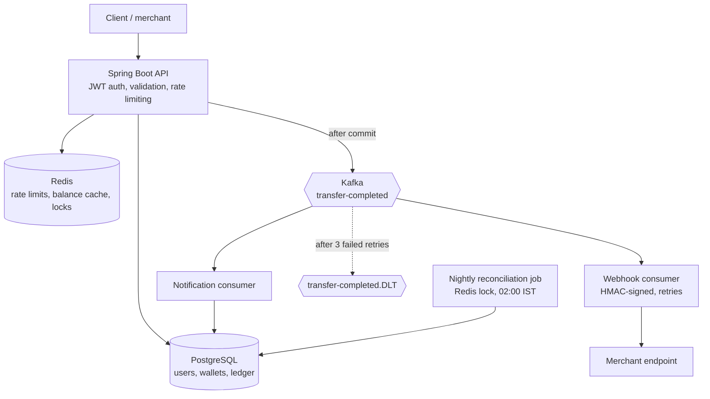

# Wallet Service

[](https://github.com/sayanah1121/wallet-service/actions/workflows/ci.yml)

A digital wallet and payments backend in Java and Spring Boot: user accounts, wallet top-ups, peer-to-peer transfers, and merchant webhooks, built around a double-entry ledger. The focus is on the hard parts of payment systems: **no double spending under concurrency, safe retries, and verifiable money integrity**.

## Architecture



## Features

- **Auth:** registration, login, JWT access tokens (15 min), rotating refresh tokens stored only as SHA-256 hashes, role-based access (USER, MERCHANT, ADMIN)
- **Wallets:** balances in paise (`BIGINT`, never floating point), paginated ledger history
- **Transfers:** atomic, with pessimistic row locking and `Idempotency-Key` support
- **Double-entry ledger:** every money movement writes a transaction plus a debit and a credit that cancel out
- **Redis:** fixed-window rate limiting (atomic Lua script) and a balance cache evicted after commit; both fail open if Redis is down
- **Kafka:** `TransferCompleted` events published after commit; in-app notifications; HMAC-SHA256 signed webhooks; exponential-backoff retries with a dead-letter topic
- **Reconciliation:** nightly job (and admin API) that verifies the ledger against wallet balances
- **Ops:** Flyway migrations, Actuator health, Dockerfile, GitHub Actions CI

## Design decisions

| Problem | Approach |
| --- | --- |
| Double spend on concurrent transfers | `SELECT ... FOR UPDATE` on both wallets inside one DB transaction; balance checked on the locked rows |
| Deadlocks between opposing transfers (A to B and B to A) | Wallets are always locked in sorted-id order |
| Client retries charging twice | `Idempotency-Key` claimed with `INSERT ... ON CONFLICT DO NOTHING` inside the transfer transaction; a duplicate waits on the unique index and then replays the saved result. The same key with a different body returns 422 |
| Rounding errors | Integer minor units (paise) end to end |
| Events for rolled-back transfers | Kafka publish and cache eviction run in `afterCommit` |
| Duplicate Kafka delivery | Notifications have a unique `(transaction_id, user_id)` constraint, so a redelivered event is a no-op |
| Leaked database | Refresh tokens are stored hashed; passwords use BCrypt |
| Silent ledger corruption | Reconciliation checks four invariants (below) |

Reconciliation invariants:

1. Every wallet balance equals the net of its ledger entries
2. Every transaction has exactly two entries that net to zero
3. No completed transaction is missing its ledger entries
4. The whole ledger nets to zero

## Tech stack

Java 21, Spring Boot 4, Spring Security, Spring Data JPA, Flyway, PostgreSQL 16, Redis 7, Apache Kafka (KRaft), JJWT, JUnit 5, Docker, GitHub Actions

## API overview

Amounts are in paise: `10000` = INR 100.00.

| Method | Path | Notes |
| --- | --- | --- |
| POST | `/api/v1/auth/register`, `/login`, `/refresh` | Public; rate limited |
| GET | `/api/v1/users/me` | Current user |
| GET | `/api/v1/wallets/me` | Balance (cached) |
| POST | `/api/v1/wallets/topup` | Credits the wallet from the system wallet |
| GET | `/api/v1/wallets/me/ledger?page=&size=` | Paginated ledger |
| POST | `/api/v1/transfers` | Requires `Idempotency-Key` header |
| GET | `/api/v1/notifications` | Latest 20 |
| POST, GET | `/api/v1/webhooks` | Register and list endpoints; the signing secret is shown once |
| POST, GET | `/api/v1/admin/reconciliation/runs` | ADMIN only |
| GET | `/api/v1/admin/reconciliation/runs/{id}/issues` | ADMIN only |

Webhook requests carry `X-Wallet-Event` and `X-Wallet-Signature: sha256=<hmac of the body>`. Receivers should verify the signature and dedupe on `transactionId`, because delivery is at least once.

## Run locally

Requires Java 21 and Docker.

```bash
docker compose up -d          # Postgres, Redis, Kafka
./mvnw spring-boot:run        # API on http://localhost:8080
```

Or run everything, including the app, in Docker:

```bash
docker compose --profile app up -d --build
```

Then try the end-to-end demo:

```bash
./scripts/demo.sh
```

## Tests

```bash
./mvnw test
```

Integration tests run against a separate `wallet_test` database (`docker exec wallet-postgres psql -U wallet -d wallet -c "create database wallet_test;"` once). They include:

- 30 parallel transfers against a balance that covers only 10: exactly 10 succeed and the balance never goes negative
- 10 simultaneous requests with the same idempotency key: money moves once
- Opposing transfers fired in parallel: no deadlock
- Reconciliation detects a deliberately corrupted balance
- Security rules: 401 without a token, 403 for a non-admin, refresh tokens work only once

CI runs the suite on every push against Postgres, Redis, and Kafka service containers, then builds the Docker image.

## Known limitations and next steps

- **Transactional outbox:** events are published after commit, so a crash between commit and publish can lose an event. An outbox table plus a relay would make publishing reliable.
- **Webhook targets:** URLs are not yet restricted, so a production version needs SSRF protection (block private and loopback ranges).
- **Rate limiting:** fixed-window counters allow a burst at window edges; a sliding window or token bucket would be smoother.
- **Secrets:** the JWT secret has a development default; production must set `JWT_SECRET`.
- **Deployment:** not hosted yet. The Docker setup is deployable to a single VM or to managed services.